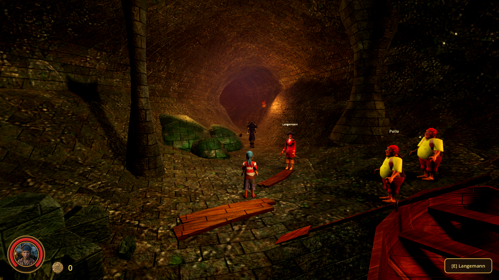
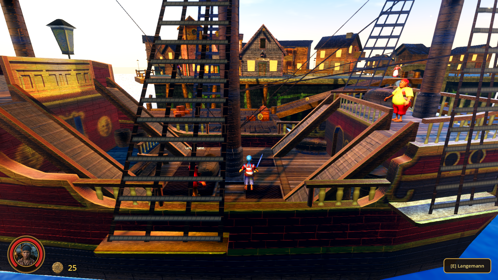
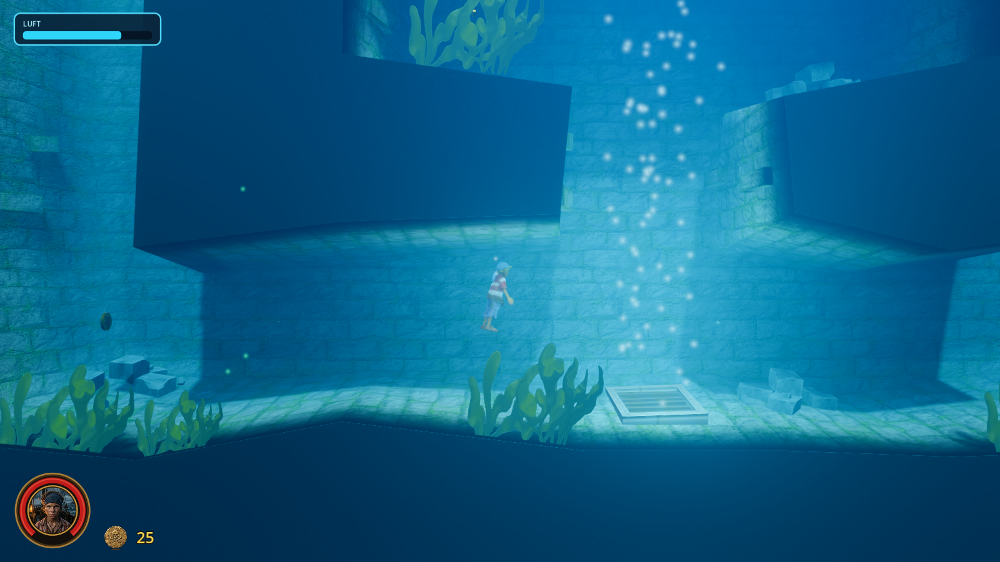
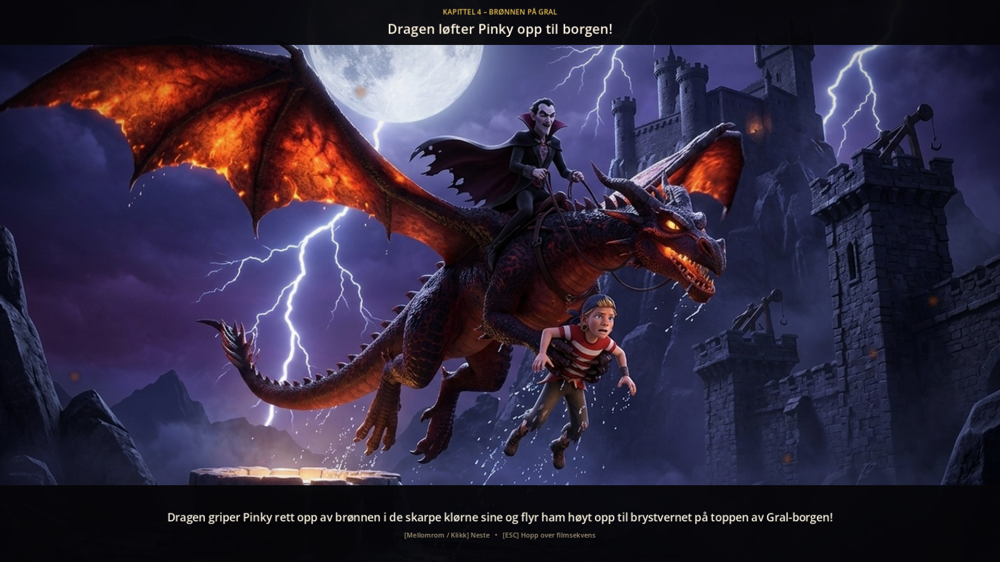

# Kaptein Sabeltann og Grusomme Gabriels forbannelse – HD Remake

-478CBF?logo=godotengine&logoColor=white)


En moderne, frittstående **Godot 4 (Forward+ PBR)** 1:1-nyversjon (*HD remake*) av 2005–2009 PC-klassikeren ***Kaptein Sabeltann og Grusomme Gabriels forbannelse*** – bygget direkte fra originalspillets dekompilerte Lingo-skript, alle 24 komplette 3D- og 2D-undervannsverdener, 24-bits høydekart (`.hm`), karaktermodeller, 450 talereplikker på norsk (+ valgfri bryter til original CD-stemme) og 808 originale lydspor.

> **Ferdig kompilert Windows-utgave (krever IKKE Godot!):** Last ned `KapteinSabeltannHD_v1.0-dev.exe` direkte under **[Releases → v1.0-dev](https://github.com/Darschnid479/KSGGFREMAKE/releases/tag/v1.0-dev)** og dobbeltklikk for å spille!


---

## Ekte skjermbilder fra HD-remaken (Godot 4 Forward+)

| Kapittel 1 – Grusomme Gabriels grotte (live 3D-åpning med stemmer) | Abra Havn – ombord på *Den Sorte Dame* |
| :---: | :---: |
|  |  |
| **De Syv Hav – Verdenskartet** | **Gral – 2D Undervanns-svømming i brønnen** |
|  |  |
| **Dragen løfter Pinky opp av brønnen til borgen** | **Gral – Bosskamp mot Greven av Gral på dragen** |
|  |  |
| **Fata Morgana – Ørkenbyen** | **Finalen – Grusomme Gabriels spøkelse** |
|  |  |

---

## Hva er inkludert i 1:1 HD-remaken (`v1.0-dev`)?

- **100 % ekte 1:1 åpning & historie-motor ([`StoryScriptEngine.gd`](godot_project/scripts/world/StoryScriptEngine.gd)):**
  - Starter live i 3D inne i den komplette **71-mesh Grusomme Gabriels grotte** (`cave.glb`) ved *Den Sorte Dame*, med Kaptein Sabeltann, Langemann, Pelle, Pysa, Skalken og Benjamin stående på grottegulvet mens de snakker og går langs originalens spline-stier.
  - Kjører originalens egne `Global`-hendelser, `areatrigger_*`-soner, karakter-splines, tresverd-funn (`pickup_woodensword`), skyvbar kasse (`cratepuzzle1`), knusbare steinvegger (`crushablewall_1/2`), Pelle-kast over lavaen (`actionable_throw`), synkende lava, kistelokket & forbannelsen (`cave_coffin_top_open`) samt alle originale mynter på eksakte koordinater.
- **450 norske karakterstemmer + undertekster + valgfri Original CD-stemme ([`AudioManager.gd`](godot_project/scripts/autoload/AudioManager.gd)):**
  - Alle 450 originale talereplikker er oversatt 1:1 til norsk med egne karakterprofiler for Pinky, Kaptein Sabeltann, Langemann, Pelle, Pysa, Skalken, Miriam av Gral, Sunniva, Greven av Gral, Maga Khan og Fortelleren – pluss **bryter i Innstillinger og Pausemeny** (`Norsk` / `Original CD`) og kinematiske norske undertekster!
- **Millimeter-nøyaktig bakkekontakt via 16 ekte 24-bits høydekart ([`HeightmapSampler.gd`](godot_project/scripts/world/HeightmapSampler.gd)):**
  - Alle 16 originale 24-bits Director-høydekart er ekstrahert til binære `.hm`-filer (`data/heightmaps/*.hm`) så verken Pinky, Sabeltann, mannskapet eller fiender noensinne svever i luften eller faller gjennom gulvet.
- **Ekte sanntids skjelett-animasjoner ([`CharacterAnimator.gd`](godot_project/scripts/world/CharacterAnimator.gd) & [`character_anim.gdshader`](godot_project/shaders/character_anim.gdshader)):**
  - Hierarkisk hofte-, lår-, kne-, legg-, overkropps-, skulder-, albue- og hode-animasjon for gange, løping, hopp, sverdhugg, kasse-dytting, skade og levende hånd-/hodegester når karakterer snakker!
- **Komplett 1:1 2D side-scrolling undervanns-svømming ([`SwimmingController.gd`](godot_project/scripts/player/SwimmingController.gd) & [`UnderwaterHazard.gd`](godot_project/scripts/world/UnderwaterHazard.gd)):**
  - 2D XY-svømmekontroll med ekte originale spline-tunnelvegger, luftmåler (`LUFT`), boblesøyler, sjøminer, haier, pirajaer, brønnkaken (`wellcake`) og fangehullsnøkkelen (`key2`).
- **Moderne AAA animasjonsspill-grafikk (Godot 4.7 Forward+ PBR):**
  - 512×512 håndlagde PBR-teksturpakker, world-space triplanar normaldetalj (`world_pbr_enhance.gdshader`), **ACES** kinokontrast, **SSAO**, **SSIL**, volumetrisk tåke, turkist skumhav (`ocean_water.gdshader`) og **7 oppskalerte animerte historie-filmsekvenser**.

---

## 100 % Original historierekkefølge (fra start til slutt)

| # | Kapittel / Nivå | Historie, 2D-dykk & Animert filmsekvens |
|---:|---|---|
| 1 | **Grusomme Gabriels grotte** (`cave`) | Live 3D-åpning med Sabeltann & mannskapet, tresverd, kassepuslespill, lava & forbannelsen ved kisten! |
| 2 | **Abra Havn** (`abra`) | Live 3D-samtaler med Sunniva, Miriam av Gral og Kjøpmannen – sett seil fra brygga! |
| 3 | **De Syv Hav – Verdenskartet** (`world_map`) | Seil *Den Sorte Dame* ovenfra + **2D skipsvrak-dykk** (`world_map_underwater`) blant haier & pirajaer |
| 4 | **Gral-fjellet** (`graal_mountain`) | Komplett 43-mesh klatretur med Pelle opp det forheksede fjellet til **brønnen (`actionable_well`)** |
| 5 | **Gral – Undervannsbrønnen (2D)** (`graal_underwater`) | **2D side-scrolling undervanns-svømming** gjennom U-tunnelen med luftmåler og boblesøyle! |
| 6 | **Gral – Bosskamp** (`graal_bosslevel`) | *Filmsekvens:* **Dragen med Greven av Gral løfter Pinky rett opp av brønnen til borgen** → Bosskamp med sverd & katapult! |
| 7 | **Fata Morgana – Byen & Brønndykk (2D)** (`fatamorgana_city` / `fatamorgana_underwater`) | *Filmsekvens:* Ørkenbyen, **2D brønndykk etter kaken (`wellcake`)**, kappkjøring og flygende teppe |
| 8 | **Fata Morgana – Palasset** (`fatamorgana_palace`) | Komplett 71-mesh palass med mørke haller, flisgåte og nøkkeljakten mot palassvokteren |
| 9 | **Fata Morgana – Bosskamp** (`fatamorgana_bosslevel`) | Oppgjøret i ørkenarenaen – låser opp Maga Khans øy |
| 10 | **Maga Khans strand** (`magakhan_beach`) | Landgang, Skalkens kokosnøtter, Malena Pirat og Benjamin |
| 11 | **Maga Khans jungel** (`magakhan_jungle`) | Panterfelle, kjøttetende plante og redning av Langemann |
| 12 | **Maga Khans palass** (`magakhan_palace`) | Storming av festningen og jakten på de 5 hellige gongene |
| 13 | **Maga Khans fangehull & Nøkkeldykk (2D)** (`magakhan_dungeon` / `magakhan_dungeon_underwater`) | Komplett 104-mesh fangehull med blå flammer, spaker, **2D undervanns-nøkkeldykk (`key2`)** og Sirikit |
| 14 | **Maga Khans drage – Sluttkamp** (`magakhan_endboss_level`) | *Filmsekvens:* Sabeltann mot Maga Khan mens Pinky distraherer dragen |
| 15 | **Tilbake til Gabriels grotte** (`cave_end`) | Komplett 54-mesh siste kamp gjennom skjelettvaktene til skattkammeret |
| 16 | **Grusomme Gabriels spøkelse – Finale** (`cave_end_bosslevel`) | *Filmsekvens:* Finalen mot Grusomme Gabriels gjenferd og vokterstatuene |
| 17 | **Forbannelsen er brutt! (Outro)** (`outro`) | *Filmsekvens:* Seiersseilas mot solnedgangen → fritt spill, Skattejakt-øya & Skipsvrak-dykk |

---

## Kontroller

| Tast / Mus | Handling |
|---|---|
| `W A S D` / Piltaster | Beveg Pinky / styr *Den Sorte Dame* / svøm i 2D |
| `Shift` | Løp |
| `Mellomrom (Space)` | Hopp / avfyr bredsider / neste replikk i filmsekvenser |
| `Venstreklikk` / `F` | Angrip / knus sprukne steinvegger |
| `E` | Snakk med NPC-er / dytt kasser / bruk portal / gå i land |
| `Tab` | Hopp til neste talereplikk |
| `L` | Slå av/på lykten i mørke grotter |
| `Høyreklikk + mus` / `Q` `R` | Roter kamera (scrollhjul for zoom) |
| `ESC` | Pause, grafikkvalg (`Medium` / `High` / `Ultra`) & stemmespråk (`Norsk` / `Original CD`) |

---

## Kom i gang (ferdig Windows `.exe` – eller kjør fra kildekode)

### Alternativ 1: Ferdig kompilert Windows-utgave (anbefalt – krever IKKE Godot!)
1. Last ned **`KapteinSabeltannHD_v1.0-dev.exe`** fra **[Releases → v1.0-dev](https://github.com/Darschnid479/KSGGFREMAKE/releases/tag/v1.0-dev)**.
2. Dobbeltklikk på `.exe`-filen for å spille rett ut av boksen (alt av 3D-verdener, høydekart, musikk og 450 stemmer er pakket inn i én enkelt fil – ingen ekstra DLL-er kreves!).

### Alternativ 2: Kjør fra kildekode i Godot 4
1. Last ned **Godot 4** (testet og verifisert i **Godot 4.7.2-stable**) fra [godotengine.org](https://godotengine.org/).
2. Klon dette repoet:
   ```bash
   git clone https://github.com/Darschnid479/KSGGFREMAKE.git
   ```
3. Åpne Godot 4, klikk **Import** og velg `godot_project/project.godot`, og trykk **F5**.

---

## Prosjektstruktur

```text
KSGGFREMAKE/
├── docs/screenshots/          # Ekte 1600x900 skjermbilder fra Godot 4 Forward+
├── godot_project/             # Komplett Godot 4.7.2-prosjekt
│   ├── project.godot          # Forward+ PBR, ACES, SSAO, SSIL, Volumetrisk tåke, MSAA 4x
│   ├── export_presets.cfg     # Standalone Windows Desktop x86_64 single-EXE (embed_pck=true)
│   ├── scenes/                # MainMenu.tscn & GameLevel.tscn
│   ├── scripts/
│   │   ├── autoload/          # LevelCatalog.gd, GameState.gd, AudioManager.gd (450 stemmer + musikk)
│   │   ├── player/            # PinkyController.gd, BoatController.gd, SwimmingController.gd, FollowCamera.gd
│   │   ├── world/             # LevelRunner.gd, StoryScriptEngine.gd, HeightmapSampler.gd, CharacterAnimator.gd, VisualEnhancer.gd, m.fl.
│   │   └── ui/                # MainMenu.gd, GameHUD.gd (med undertekster & stemmevelger), CutscenePlayer.gd
│   ├── shaders/               # character_anim, ocean_water, stylized_sky, storm_sky, island_terrain, world_pbr_enhance, ship_wake, cutscene_fx
│   ├── data/
│   │   ├── gameplay/          # 33 ekstraherte originale nivådata-JSON-er
│   │   ├── heightmaps/        # 16 ekstraherte 24-bits binære høydekart (.hm)
│   │   └── dialogues.json     # Alle 450 1:1 norske talereplikker med rollefordeling
│   └── assets/
│       ├── cutscenes/         # 7 oppskalerte Pixar-stil 1600x900 animerte historie-sekvenser
│       ├── levels/            # 24 komplette HD PBR .glb-verdener (inkl. 71-mesh cave, graal_mountain, fatamorgana_palace, magakhan_dungeon)
│       ├── models/            # 22 HD PBR .glb-karaktermodeller
│       ├── textures/pbr/      # 512x512 moderne AAA PBR-teksturpakker
│       ├── ui/                # HUD-medaljong og preget gull-dublon
│       ├── audio/             # Originale OGG-lydeffekter & bakgrunnsmusikk
│       ├── voices_no/         # 450 norske karakterstemmer (OGG)
│       └── voices_orig/       # 450 originale CD-stemmer (valgfri bryter)
└── tools/                     # Reproduserbar W3D -> HD PBR GLB, høydekart, lyd- og stemme-pipeline
```


> **Merknad:** Dette er et ikke-kommersielt fan- og bevaringsprosjekt laget for å modernisere et eldre Shockwave 3D-spill på dagens maskinvare. Alle rettigheter til *Kaptein Sabeltann* tilhører sine respektive rettighetshavere.
