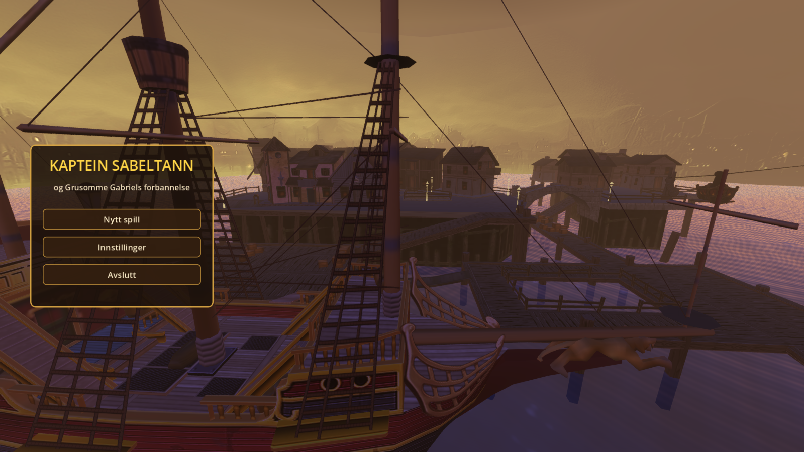
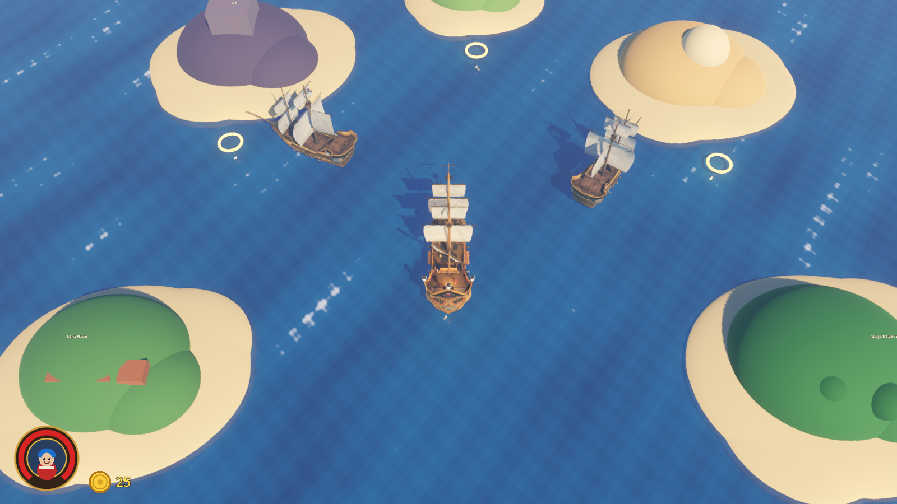
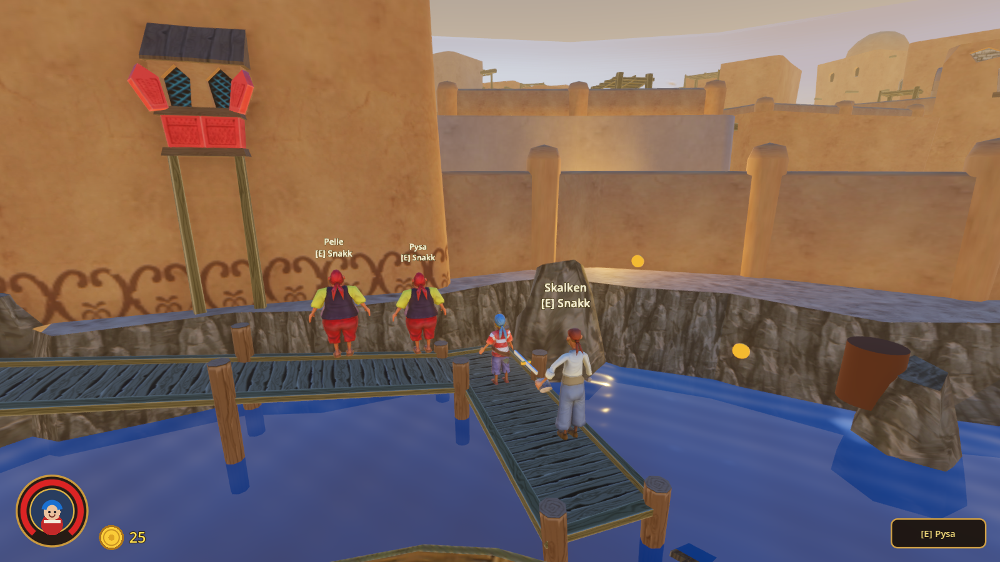

# Kaptein Sabeltann og Grusomme Gabriels forbannelse – HD Remake

-478CBF?logo=godotengine&logoColor=white)


En moderne, frittstående **Godot 4 (Forward+ PBR)** nyversjon (*recompile / HD remake*) av 2005–2009 PC-klassikeren ***Kaptein Sabeltann og Grusomme Gabriels forbannelse*** – bygget direkte fra originalspillets dekompilerte Lingo-skript, 3D-verdener, karaktermodeller og originale lydspor, oppskalert til moderne HD-grafikk.



---

## Ekte skjermbilder fra HD-remaken (Godot 4 Forward+)

| Abra Havn – ombord på *Den Sorte Dame* | De Syv Hav – Verdenskartet |
| :---: | :---: |
|  |  |
| **Fata Morgana – Ørkenbyen** | **Gral – Bossarenaen** |
|  |  |

### Finalen – Grusomme Gabriels spøkelse


---

## Hva er modernisert i HD-remaken?

- **Moderne 3D-motor (Godot 4 Forward+ PBR):** Native desktop-spill i 1080p/4K (ikke web) med MSAA 4x, 4K PCF5 myke skygger, SSAO, ACES Filmic tonemapping, glow/bloom og atmosfærisk tåke per biom.
- **4x Oppskalerte HD-teksturer + automatisk PBR-syntese:**
  - **14 originale 3D-verdener (177 MB)** og **22 karaktermodeller (24 MB)** er konvertert fra Macromedia Shockwave 3D (`.w3d`) til moderne glTF 2.0 (`.glb`).
  - Alle teksturer er oppskalert **4x** (opptil `1024×1024`) med kantbevarende Lanczos + detaljskarphet, samt automatisk genererte **tangent-space PBR Normal Maps** og **ORM (Occlusion / Roughness / Metallic)**-kart.
- **Animert Gerstner-havshader:** Egen spesialskrevet vannshader ([`ocean_water.gdshader`](godot_project/shaders/ocean_water.gdshader)) med bølgebevegelse, Fresnel-refleksjon, solglimt og bølgeskum.
- **Original musikk og lydeffekter:** **92 rene OGG-lydspor og bakgrunnsmusikk** ekstrahert fra spillets originale `.cct`-arkiver for alle biomer (renset for russisk dubbing).
- **Norsk 1:1 UI og historieflyt:** Original-tro HUD med Pinkys runde helsemedaljong og gullmynter nederst til venstre, kontekstuelt `[E]`-handlingsikon nederst til høyre, fugleperspektiv på verdenskartet med *Den Sorte Dame*, og steg-for-steg historieflyt gjennom alle 18 verdener fra Grusomme Gabriels grotte til finalen.

---

## Alle 18 spillbare verdener (historieflyt)

| # | Nivå | Biom / Modus |
|---:|---|---|
| 1 | **Grusomme Gabriels grotte** | Intro-grotte og skattkammer |
| 2 | **Abra Havn** | Sjørøverlandsbyen & *Den Sorte Dame* |
| 3 | **De Syv Hav – Verdenskartet** | Seil *Den Sorte Dame* sett ovenfra mellom øyene |
| 4 | **Gral-fjellet** | Forhekset fjellandskap |
| 5 | **Gral – Bosskamp** | Bosskamp oppe på Gral-borgen |
| 6 | **Fata Morgana – Byen** | Ørkenbyen og basaren |
| 7 | **Fata Morgana – Palasset** | Sultanens indre haller |
| 8 | **Fata Morgana – Bosskamp** | Ørkenarena |
| 9 | **Maga Khans strand** | Landgang i jungelriket |
| 10 | **Maga Khans jungel** | Kjøttetende planter og pantere |
| 11 | **Maga Khans palass** | Festning og gårdsplass (69 HD-meshes) |
| 12 | **Maga Khans fangehull** | Fangehull, feller og gåter |
| 13 | **Maga Khans drage – Sluttkamp** | Drage-bosskamp |
| 14 | **Tilbake til Gabriels grotte** | Siste etappe mot forbannelsen |
| 15 | **Grusomme Gabriels spøkelse – Finale** | Finalekamp mot spøkelset |
| 16 | **Skattejakt-øya** | Tropisk skattejakt |
| 17 | **Undervannsdykk** | Svømmemodus på havbunnen |
| 18 | **Forbannelsen er brutt! (Outro)** | Seiersfest i Abra Havn ved solnedgang |

---

## Kontroller

| Tast / Mus | Handling |
|---|---|
| `W A S D` / Piltaster | Beveg Pinky / styr *Den Sorte Dame* |
| `Shift` | Løp |
| `Mellomrom (Space)` | Hopp / avfyr bredsider på skipet |
| `Venstreklikk` / `F` | Angrip |
| `E` | Snakk med NPC-er / bruk portal / gå i land |
| `L` | Slå av/på lykten i mørke grotter |
| `Høyreklikk + mus` / `Q` `R` | Roter kamera (scrollhjul for zoom) |
| `ESC` | Pause og grafikkvalg (`Medium` / `High` / `Ultra`) |

---

## Kom i gang (kjør eller bygg `.exe`)

1. Last ned **Godot 4** (4.3 eller nyere – testet og verifisert i **Godot 4.7.2-stable**) fra [godotengine.org](https://godotengine.org/).
2. Klon dette repoet:
   ```bash
   git clone https://github.com/Darschnid479/KSGGFREMAKE.git
   ```
3. Åpne Godot 4, klikk **Import** og velg `godot_project/project.godot`.
4. Trykk **F5** for å spille direkte – eller gå til **Project → Export** for å kompilere en frittstående **Windows `.exe`**, Linux eller macOS-kjørbar fil.

---

## Prosjektstruktur

```text
KSGGFREMAKE/
├── docs/screenshots/          # Ekte 1600x900 skjermbilder fra Godot 4 Forward+
├── godot_project/             # Komplett Godot 4-prosjekt
│   ├── project.godot          # Forward+ PBR, MSAA 4x, 4K skygger, kontroller
│   ├── scenes/                # MainMenu.tscn & GameLevel.tscn
│   ├── scripts/
│   │   ├── autoload/          # LevelCatalog.gd, GameState.gd, AudioManager.gd
│   │   ├── player/            # PinkyController.gd, BoatController.gd, FollowCamera.gd
│   │   ├── world/             # LevelRunner.gd, NpcActor.gd, EnemyActor.gd, m.fl.
│   │   └── ui/                # MainMenu.gd, GameHUD.gd
│   ├── shaders/               # ocean_water.gdshader (Gerstner-hav)
│   ├── data/gameplay/         # 33 ekstraherte originale nivådata-JSON-er
│   └── assets/
│       ├── levels/            # 14 HD PBR .glb-verdener
│       ├── models/            # 22 HD PBR .glb-karaktermodeller
│       └── audio/             # 92 originale OGG-lydspor & bakgrunnsmusikk
├── data/                      # Dekompilerte metadata (spawns, skjeletter, heightmaps)
└── tools/                     # Reproduserbar W3D -> 4x HD PBR GLB & lyd-pipeline
```

---

## Teknisk pipeline (`tools/`)

- [`extract_gameplay_metadata.py`](tools/extract_gameplay_metadata.py) – Parser Shockwave 3D `.w3d`-scenenoder, skjeletter, animasjoner og Lingo `heightmap_info.ls`.
- [`upscale_and_pack_glb.py`](tools/upscale_and_pack_glb.py) – 4x teksturoppskalering, flerskals Sobel PBR Normal Map + materialbevisst ORM-generering, og glTF 2.0 `.glb`-pakking (Z-up → Y-up).
- [`fix_character_poses.py`](tools/fix_character_poses.py) – Myk skulder- og albuetransformasjon som konverterer alle 19 humanoide karaktermodeller fra statisk T-pose til naturlig sjørøverstilling med oppdaterte PBR-normaler.
- [`batch_convert_game.py`](tools/batch_convert_game.py) – Automatisert parallell batch-konvertering av `.w3d` til HD PBR `.glb`.
- [`extract_original_audio.py`](tools/extract_original_audio.py) – Ekstraherer klassiske Mac `snd `-ressurser fra Director `.cct`-arkiver til OGG Vorbis.

> **Merknad:** Dette er et ikke-kommersielt fan- og bevaringsprosjekt laget for å modernisere et eldre Shockwave 3D-spill på dagens maskinvare. Alle rettigheter til *Kaptein Sabeltann* tilhører sine respektive rettighetshavere.
