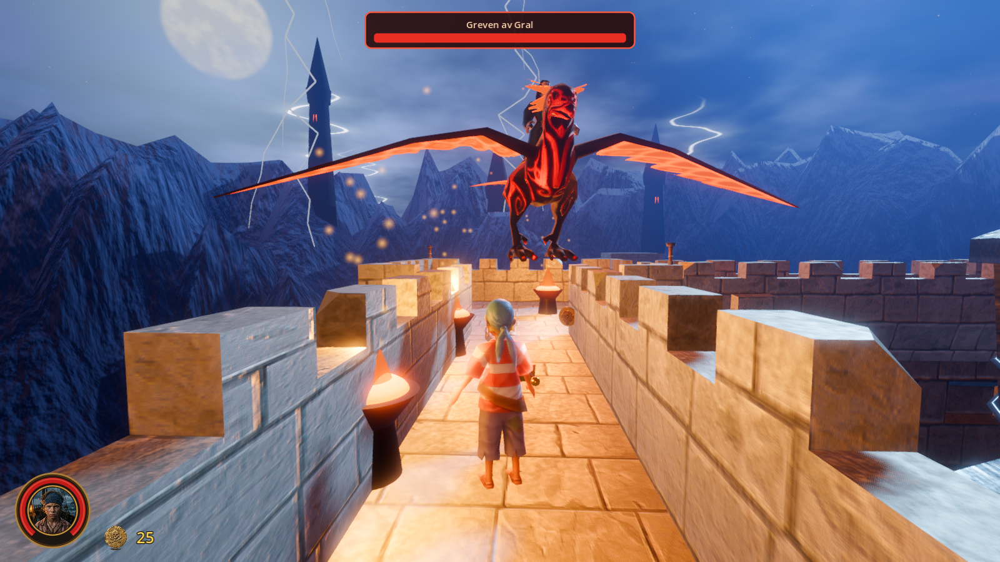
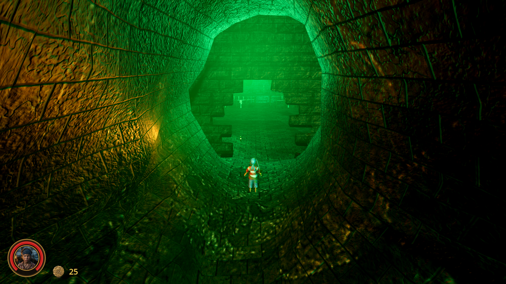
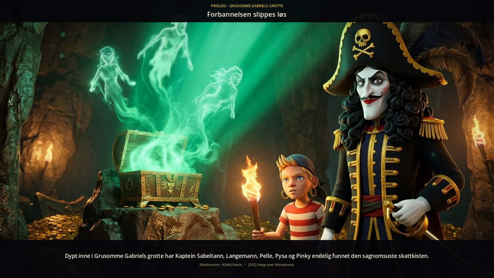

# Kaptein Sabeltann og Grusomme Gabriels forbannelse – HD Remake

-478CBF?logo=godotengine&logoColor=white)


En moderne, frittstående **Godot 4 (Forward+ PBR)** nyversjon (*recompile / HD remake*) av 2005–2009 PC-klassikeren ***Kaptein Sabeltann og Grusomme Gabriels forbannelse*** – bygget direkte fra originalspillets dekompilerte Lingo-skript, 3D-verdener, karaktermodeller og originale lydspor, oppgradert til **moderne animasjonsspill-grafikk** (AgX, SSAO, SSIL indirekte lys, volumetrisk tåke, turkist skumhav og Pixar-inspirert belysning) med **100 % tro original historieflyt** og **7 oppskalerte animerte historie-filmsekvenser**.


---

## Ekte skjermbilder fra HD-remaken (Godot 4 Forward+)

| Abra Havn – ombord på *Den Sorte Dame* | De Syv Hav – Verdenskartet |
| :---: | :---: |
|  |  |
| **Fata Morgana – Ørkenbyen** | **Gral – Bosskamp mot Greven av Gral på dragen** |
|  |  |
| **Finalen – Grusomme Gabriels spøkelse** | **Oppskalerte animerte historie-filmsekvenser** |
|  |  |

---

## Hva er modernisert i HD-remaken?

- **Moderne AAA animasjonsspill-grafikk (Godot 4.7 Forward+ PBR):**
  - **AgX Filmic tonemapping**, **SSAO**, **SSIL (sanntids indirekte bounce-lys)**, **Volumetrisk tåke**, **4K PCF5 myke skygger**, **MSAA 4x** og 16x anisotropisk filtrering.
  - **Malte volumetriske skyhimler** ([`stylized_sky.gdshader`](godot_project/shaders/stylized_sky.gdshader) & [`storm_sky.gdshader`](godot_project/shaders/storm_sky.gdshader)) som erstatter originalens gamle 2005-bakgrunnskupler med gyllen solnedgang, karibiske skyer og månelyst uvær over Gral-borgen.
  - **Neste-generasjons skumhav** ([`ocean_water.gdshader`](godot_project/shaders/ocean_water.gdshader) & [`ship_wake.gdshader`](godot_project/shaders/ship_wake.gdshader)) med ekte `DEPTH_TEXTURE`-absorpsjon (turkis grunne → safirblått dyp), automatisk hvitt kystskum rundt bryggestolper og øystrender, undervanns-kaustikk, solglimt og organiske V-kjølvann bak skipene.
  - **Triplanar PBR mikrodetalj & Pixar karakter-kantglød** ([`world_pbr_enhance.gdshader`](godot_project/shaders/world_pbr_enhance.gdshader) & [`VisualEnhancer.gd`](godot_project/scripts/world/VisualEnhancer.gd)): skarpe nærdetaljer på treverk, stein og grotter, våt glans langs vannlinjen, varme glødende husvinduer, brennende smijerns-fakkelfat på Gral-borgen, håndlagde buede eiketønner og pregede 3D-gullmynter.
- **4x Oppskalerte HD-teksturer + automatisk PBR-syntese:**
  - **14 originale 3D-verdener (177 MB)** og **22 karaktermodeller (24 MB)** konvertert fra Shockwave 3D (`.w3d`) til moderne glTF 2.0 (`.glb`) med 4x oppskalering, Normal Maps og ORM-kart, samt fikset T-pose på alle 19 humanoide karakterer og Greven av Gral på dragen.
- **100 % original historieflyt + 7 oppskalerte animerte historie-filmsekvenser:**
  - Følger den eksakte originale historien steg-for-steg fra `gameplayw3ds/*.w3d` – fra forbannelsen slippes løs i **Grusomme Gabriels grotte**, via **Abra Havn** (Miriams spådom), **Gral**, **Fata Morgana** og **Maga Khans øy**, helt til oppgjøret mot **Grusomme Gabriels spøkelse** og seiersseilasen i **Outro**.
  - [`CutscenePlayer.gd`](godot_project/scripts/ui/CutscenePlayer.gd) spiller automatisk av **7 oppskalerte Pixar-stil 2.5D animerte filmsekvenser** (med Ken Burns kamera-panorering, sanntids lyspartikkel-shader, 2.39:1 filmstriper, norsk fortellertekst og original musikk) ved hvert hovedkapittel.
- **Original musikk og lydeffekter:** **92 rene OGG-lydspor og bakgrunnsmusikk** ekstrahert fra spillets originale `.cct`-arkiver for alle biomer (renset for russisk dubbing).

---

## 100 % Original historierekkefølge (fra start til slutt)

| # | Kapittel / Nivå | Historie & Animert filmsekvens |
|---:|---|---|
| 1 | **Grusomme Gabriels grotte** (`cave`) | *Filmsekvens 1:* Kisten åpnes og forbannelsen slippes løs! |
| 2 | **Abra Havn** (`abra`) | *Filmsekvens 2:* Miriam av Gral avslører de 3 øyene i krystallkulen |
| 3 | **De Syv Hav – Verdenskartet** (`world_map`) | Seil *Den Sorte Dame* ovenfra mot neste opplåste historie-øy |
| 4 | **Gral-fjellet** (`graal_mountain`) | Klatretur med Pelle opp det forheksede fjellet til borgen |
| 5 | **Gral – Bosskamp** (`graal_bosslevel`) | *Filmsekvens 3:* Bosskamp oppe på borgen mot Greven av Gral på dragen |
| 6 | **Fata Morgana – Byen** (`fatamorgana_city`) | *Filmsekvens 4:* Ørkenbyen, kakeoppdrag, kappkjøring og flygende teppe |
| 7 | **Fata Morgana – Palasset** (`fatamorgana_palace`) | Mørke haller, flisgåte og nøkkeljakten mot palassvokteren |
| 8 | **Fata Morgana – Bosskamp** (`fatamorgana_bosslevel`) | Oppgjøret i ørkenarenaen – låser opp Maga Khans øy |
| 9 | **Maga Khans strand** (`magakhan_beach`) | Landgang, Skalkens kokosnøtter, Malena Pirat og Benjamin |
| 10 | **Maga Khans jungel** (`magakhan_jungle`) | Panterfelle, kjøttetende plante og redning av Langemann |
| 11 | **Maga Khans palass** (`magakhan_palace`) | Storming av festningen og jakten på de 5 hellige gongene |
| 12 | **Maga Khans fangehull** (`magakhan_dungeon`) | Blå flammer, spaker, nøkkeldykk og møtet med Sirikit |
| 13 | **Maga Khans drage – Sluttkamp** (`magakhan_endboss_level`) | *Filmsekvens 5:* Sabeltann mot Maga Khan mens Pinky distraherer dragen |
| 14 | **Tilbake til Gabriels grotte** (`cave_end`) | Siste kamp gjennom skjelettvaktene til skattkammeret |
| 15 | **Grusomme Gabriels spøkelse – Finale** (`cave_end_bosslevel`) | *Filmsekvens 6:* Finalen mot Grusomme Gabriels gjenferd og vokterstatuene |
| 16 | **Forbannelsen er brutt! (Outro)** (`outro`) | *Filmsekvens 7:* Seiersseilas mot solnedgangen → fritt spill, Skattejakt-øya & Undervannsdykk |

---

## Kontroller

| Tast / Mus | Handling |
|---|---|
| `W A S D` / Piltaster | Beveg Pinky / styr *Den Sorte Dame* |
| `Shift` | Løp |
| `Mellomrom (Space)` | Hopp / avfyr bredsider / neste replikk i filmsekvenser |
| `Venstreklikk` / `F` | Angrip |
| `E` | Snakk med NPC-er / bruk portal / gå i land |
| `L` | Slå av/på lykten i mørke grotter |
| `Høyreklikk + mus` / `Q` `R` | Roter kamera (scrollhjul for zoom) |
| `ESC` | Pause og grafikkvalg (`Medium` / `High` / `Ultra`) / hopp over filmsekvens |

---

## Kom i gang (kjør eller bygg `.exe`)

1. Last ned **Godot 4** (4.3 eller nyere – testet og verifisert i **Godot 4.7.2-stable**) fra [godotengine.org](https://godotengine.org/).
2. Klon dette repoet:
   ```bash
   git clone https://github.com/Darschnid479/KSGGFREMAKE.git
   ```
3. Åpne Godot 4, klikk **Import** og velg `godot_project/project.godot`.
4. Trykk **F5** for å spille direkte – eller gå til **Project → Export** for å kompilere en frittstående **Windows `.exe`**, Linux eller macOS-kjørbar fil.

---

## Prosjektstruktur

```text
KSGGFREMAKE/
├── docs/screenshots/          # 7 ekte 1600x900 skjermbilder fra Godot 4 Forward+
├── godot_project/             # Komplett Godot 4-prosjekt
│   ├── project.godot          # Forward+ PBR, AgX, SSAO, SSIL, Volumetrisk tåke, MSAA 4x
│   ├── scenes/                # MainMenu.tscn & GameLevel.tscn
│   ├── scripts/
│   │   ├── autoload/          # LevelCatalog.gd, GameState.gd (100% historiemotor), AudioManager.gd
│   │   ├── player/            # PinkyController.gd, BoatController.gd, FollowCamera.gd
│   │   ├── world/             # LevelRunner.gd, VisualEnhancer.gd, NpcActor.gd, EnemyActor.gd, m.fl.
│   │   └── ui/                # MainMenu.gd, GameHUD.gd, CutscenePlayer.gd
│   ├── shaders/               # ocean_water, stylized_sky, storm_sky, island_terrain, world_pbr_enhance, ship_wake, cutscene_fx
│   ├── data/gameplay/         # 33 ekstraherte originale nivådata-JSON-er
│   └── assets/
│       ├── cutscenes/         # 7 oppskalerte Pixar-stil 1600x900 animerte historie-sekvenser
│       ├── levels/            # 14 HD PBR .glb-verdener
│       ├── models/            # 22 HD PBR .glb-karaktermodeller
│       ├── ui/                # Live-action/HD HUD-medaljong og preget gull-dublon
│       └── audio/             # 92 originale OGG-lydspor & bakgrunnsmusikk
├── data/                      # Dekompilerte metadata (spawns, skjeletter, heightmaps)
└── tools/                     # Reproduserbar W3D -> 4x HD PBR GLB, pose-fiks & lyd-pipeline
```

> **Merknad:** Dette er et ikke-kommersielt fan- og bevaringsprosjekt laget for å modernisere et eldre Shockwave 3D-spill på dagens maskinvare. Alle rettigheter til *Kaptein Sabeltann* tilhører sine respektive rettighetshavere.
